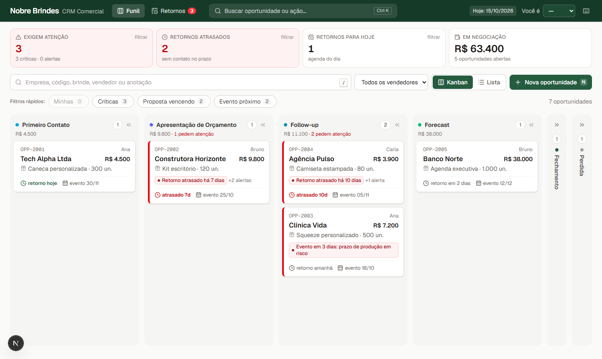
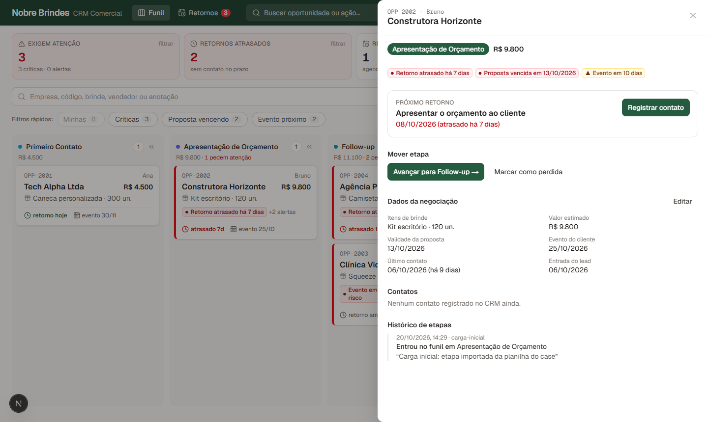
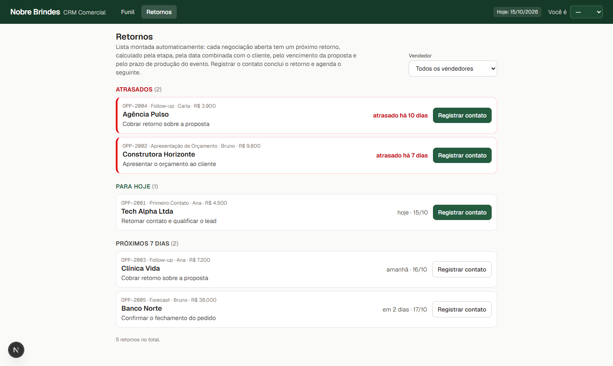

# CRM Nobre Brindes

Primeira versão de um CRM para o time comercial da Nobre Brindes. Dá para acompanhar as oportunidades, mover cada uma pelo funil e ver logo de cara quais negociações precisam de atenção hoje.



| Detalhe da oportunidade | Agenda de retornos |
| --- | --- |
|  |  |

## Como rodar

Precisa de Node 20+ (usei o 24) e Docker.

```bash
cp .env.example .env                 # troque a senha (em POSTGRES_PASSWORD e nas DATABASE_URL)
cp web/.env.example web/.env.local
npm run setup                        # instala api/ e web/
npm run db:up                        # Postgres 16 na porta 5433 (cria também o banco de testes)
npm run db:reset                     # cria as tabelas e carrega os dados do case
npm run dev:api                      # http://localhost:3333
npm run dev:web                      # http://localhost:3000 (em outro terminal)
```

No PowerShell é `copy` em vez de `cp`.

Outros comandos:

- `npm test`: testes da API (unitários e de integração). Os de integração precisam do banco rodando.
- `npm run lint`: typecheck da API e lint do front.
- `npm run job:follow-ups`: roda o job de follow-up uma vez.

Os dados do case são de 15/10/2026, então o `.env.example` já vem com `REFERENCE_DATE=2026-10-15`. As regras de atraso e vencimento usam essa data como "hoje", e ela aparece no topo da tela. Com a variável vazia, vale a data real.

## Estrutura

```
api/    Node + TypeScript + Fastify + PostgreSQL
  src/domain/        regras de negócio (funções puras, sem banco)
  src/services/      casos de uso: transação, validação, histórico
  src/repositories/  SQL
  src/automation/    job de follow-up e resumo diário
  src/db/            migrations e carga inicial
  test/              unitários e integração
web/    Next.js 16 + React 19 + Tailwind + TanStack Query
  src/app/api/[...path]   proxy para a API
  src/components/         quadro, detalhe, agenda
```

Algumas escolhas:

- Deixei as regras em `api/src/domain` sem depender de banco nem de HTTP. Assim dá para testar cada regra direto, inclusive com os casos da tabela do enunciado.
- Usei SQL direto em vez de ORM. São poucas tabelas, e eu queria controlar a transação, o lock e as constraints sem nada escondido.
- O front não chama a API direto. Ele chama `/api/*` do próprio Next, que repassa para a API. A chave da API fica no servidor e não aparece no navegador.

### Endpoints

| Método | Rota | O que faz |
| --- | --- | --- |
| GET | `/opportunities` | lista (filtros: `search`, `sellerId`, `stage`, `needsAttention`) |
| GET | `/opportunities/:id` | detalhe com histórico e contatos |
| POST | `/opportunities` | cria em Primeiro Contato |
| PATCH | `/opportunities/:id` | edita dados e itens |
| POST | `/opportunities/:id/stage-transitions` | muda de etapa (`toStage`, `expectedFromStage`, `reason`) |
| POST | `/opportunities/:id/contacts` | registra um contato |
| GET | `/follow-ups/agenda` | retornos atrasados, de hoje e dos próximos 7 dias |
| POST | `/follow-ups/run` | roda o job na hora |
| GET | `/meta`, `/sellers`, `/health` | etapas, vendedores, health check |

Os erros saem sempre no formato `{ "error": { "code", "message", "details" } }`. A mensagem já vem pronta para mostrar na tela.

## Regras do funil

Primeiro Contato → Apresentação de Orçamento → Follow-up → Forecast → Fechamento. Perdida pode vir de qualquer etapa aberta. Fechamento e Perdida são finais.

Regras do enunciado:

- Para ir para Apresentação de Orçamento, precisa de valor estimado e pelo menos um item de brinde.
- Fechamento só a partir de Forecast.
- Perdida exige motivo.

Regras que eu defini:

- **O avanço é sempre uma etapa por vez.** Cada etapa é uma coisa que precisa acontecer (orçar, cobrar, prever), e pular uma é pular a checagem dela.
- **Follow-up exige a data de validade da proposta.** Follow-up é cobrar uma proposta enviada; sem validade não tem prazo para cobrar. Por isso faz sentido a OPP-2001 estar sem validade: ela ainda está em Primeiro Contato.
- **Não fecha com proposta vencida.** O preço de brinde personalizado muda, e fechar em cima de proposta vencida é arriscar a margem. Resolve renovando a validade ou voltando para orçamento.
- **Os requisitos valem também na edição.** Não dá para apagar o valor de uma oportunidade que já está em Follow-up, senão a regra seria contornada editando depois.

Retornos de etapa (todos pedem motivo, que fica no histórico):

| De | Para | Pode? | Por quê |
| --- | --- | --- | --- |
| Follow-up | Apresentação de Orçamento | sim | cliente pediu revisão |
| Forecast | Follow-up | sim | cliente esfriou ou adiou a decisão |
| Forecast | Apresentação de Orçamento | sim | mudou o escopo, precisa de proposta nova |
| qualquer | Primeiro Contato | não | o contato já aconteceu; voltar bagunçaria o SLA e o histórico |
| Fechamento / Perdida | qualquer | não | são finais; se o cliente voltar, abre outra oportunidade |

A lista de retornos está em [`api/src/domain/stages.ts`](api/src/domain/stages.ts). A API devolve ela em `/meta`, e o front usa só para destacar as colunas onde dá para soltar o card. Quem valida é sempre a API.

## Consistência dos dados

- Toda regra é validada na API. Uma chamada direta, sem passar pela tela, recebe o mesmo erro.
- O banco tem constraints para os casos mais graves: Perdida sem motivo, oportunidade sem valor depois do orçamento, mais de um retorno aberto por oportunidade.
- A mudança de etapa roda numa transação que trava a linha (`FOR UPDATE`): valida, grava a etapa, grava o histórico e recalcula o retorno. Ou vai tudo, ou nada.
- O front manda a etapa que estava vendo (`expectedFromStage`). Se alguém já tiver movido o card, a API devolve 409 em vez de sobrescrever. Tem teste com duas mudanças ao mesmo tempo.
- O histórico guarda data, etapa de origem, etapa de destino, tipo (avanço, retorno ou perda), motivo e quem fez.

## O que exige atenção

A ideia é o vendedor abrir a tela e saber em segundos onde mexer. Cada oportunidade aberta recebe um nível (crítico, alerta ou ok) e os motivos:

| Situação | Alerta | Crítico |
| --- | --- | --- |
| retorno atrasado | 1 ou 2 dias | 3 dias ou mais |
| lead sem primeiro contato | | a partir do dia seguinte à entrada |
| validade da proposta | vence em até 3 dias | vencida |
| evento do cliente | em até 14 dias | em até 7 dias (prazo de produção) ou já passou |
| proposta sem validade em Follow-up/Forecast | sim | |

Na tela, isso aparece em quatro lugares:

- No topo, um resumo: quantas negociações pedem atenção, quantos retornos estão atrasados, quantos são para hoje e o valor em negociação. O botão "Ver só essas" filtra o quadro.
- Nos cards: borda vermelha ou amarela e o motivo escrito ("Retorno atrasado há 7 dias"). Dentro de cada coluna, os mais urgentes vêm primeiro.
- Busca por empresa, código ou brinde, e filtro por vendedor.
- Telas de carregando, erro (com "Tentar novamente") e "nada encontrado". Se a API recusar um movimento, o card volta para o lugar e aparece o motivo.

Dá para arrastar com mouse ou no celular. Pelo teclado, Enter abre o detalhe, que tem os botões de avançar, voltar e marcar como perdida.

Com os dados do case aparecem três críticas: Construtora Horizonte (sem retorno há 7 dias, proposta vencida, evento em 10 dias), Agência Pulso (atrasada há 10 dias, proposta vencida) e Clínica Vida (evento em 3 dias).

## Automação: problema 4 (retornos de follow-up)

Escolhi esse porque o próprio case diz que é o follow-up que decide a venda, e porque dá para resolver só com os dados que o CRM já tem.

Como funciona:

1. Toda oportunidade aberta tem um próximo retorno, guardado em `follow_up_tasks`. A data é a mais cedo entre:
   - a cadência da etapa, contada do último contato (1 dia em Primeiro Contato, 2 em Orçamento, 3 em Follow-up, 2 em Forecast), ou a data que o cliente pediu, se tiver;
   - a véspera do vencimento da proposta;
   - 7 dias antes do evento, por causa do prazo de produção;
   - para lead sem nenhum contato, o próprio dia em que ele entrou.

   Se um desses prazos caiu antes do último contato, ele é ignorado, porque o vendedor já falou com o cliente depois disso. O cálculo está em [`api/src/domain/follow-up.ts`](api/src/domain/follow-up.ts).
2. Quando o vendedor registra um contato, o retorno atual é concluído e o próximo é agendado. Mudar de etapa ou editar validade/evento também recalcula. Fechar ou perder cancela o retorno.
3. Um job ([`api/src/automation/follow-up-job.ts`](api/src/automation/follow-up-job.ts)) roda a cada 15 minutos e faz duas coisas:
   - confere se todos os retornos estão certos. Pode rodar quantas vezes quiser sem duplicar nada;
   - manda para cada vendedor um resumo do dia com os retornos atrasados e os de hoje, no log ou num webhook (Slack, Teams, n8n). Sai no máximo um por vendedor por dia, e se o webhook falhar ele tenta de novo na próxima rodada.
4. A tela "Retornos" é a agenda do vendedor (atrasados, hoje e próximos 7 dias), com o botão de registrar contato direto na lista.

Exemplo de resumo com os dados do case:

```
Bom dia, Bruno! Seus retornos de 15/10/2026:

ATRASADOS (1)
• OPP-2002 Construtora Horizonte: Apresentar o orçamento ao cliente (atrasado há 7 dias)
```

Em produção eu tiraria o job de dentro da API e chamaria `npm run job:follow-ups` por um agendador (cron, Cloud Scheduler), com o resumo saindo às 8h.

## Os outros três problemas

**1. Lead esperando o primeiro contato.** O lead precisa entrar sozinho no CRM e já ter um responsável. Eu faria:

- um endpoint de entrada (site, formulário, WhatsApp) que cria a oportunidade com data e hora de chegada;
- distribuição automática por rodízio, levando em conta quantas oportunidades cada vendedor já tem;
- um job de minuto em minuto que avisa o responsável e, se ninguém registrar contato em uns 15 minutos, passa o lead para outra pessoa ou avisa o gestor;
- uma resposta automática para o lead ("a Ana vai te chamar em até 15 minutos") e o tempo até o primeiro contato como métrica.

O planejador de retornos já trata lead sem contato. O que falta é trocar a data por data e hora e criar esse job mais rápido.

**2. Conhecer a empresa do lead.** Com o CNPJ ou o domínio do e-mail, um job em segundo plano buscaria:

- os dados públicos (BrasilAPI/Receita: porte, ramo, endereço) e o site da empresa;
- um resumo curto gerado com LLM, com segmento, datas importantes do setor, brindes que costumam funcionar para esse perfil e perguntas para a ligação;
- se a empresa já comprou de alguma marca do grupo.

Isso apareceria no detalhe da oportunidade, guardado por CNPJ para não consultar de novo.

**3. Informações da ligação.** Primeiro, transformaria o roteiro num formulário dentro do "Registrar contato" (quantidade, orçamento, data do evento, quem decide). As respostas já preencheriam a oportunidade, que é justamente o que libera o avanço de etapa. Depois, daria para gravar a ligação com consentimento, transcrever e extrair os campos automaticamente, com o vendedor conferindo antes de salvar.

## Segurança

O que já está feito:

- Nenhuma credencial vai para o repositório. Só o `.env.example` é versionado.
- A API pode exigir uma chave (`API_KEY`), comparada em tempo constante. Quem envia a chave é o servidor do Next, então ela não chega ao navegador.
- Toda entrada é validada com zod, e as queries são parametrizadas.
- Erro inesperado não devolve detalhes internos para o cliente.

Para produção eu faria:

- login com a conta da empresa (Google ou Microsoft) no Next, com um token repassado para a API validar;
- permissão por papel: o vendedor vê as próprias oportunidades, o gestor vê todas. Hoje o nome no histórico vem de um header informativo, que não é autenticação;
- a API fechada na rede interna, aceitando só o Next;
- rate limit, HTTPS, segredos num gerenciador de segredos e um usuário de banco sem permissão de alterar tabelas.

## Testes

São 93 testes na API:

- `test/unit`: regras de etapa (incluindo todas as do enunciado), atenção, cálculo dos retornos e resumo diário;
- `test/integration`: API com Postgres de verdade: transições, histórico, concorrência, constraints, contatos, job e chave da API.

Os testes de integração usam um banco separado (`nobre_crm_test`), recriado a cada execução. O CI em [`.github/workflows/ci.yml`](.github/workflows/ci.yml) roda os testes, o lint e o build do front.

## Dados do case

Como tratei os campos em branco e o que faltava na planilha:

- **OPP-2001 sem validade:** está em Primeiro Contato, então ainda não tem proposta. Só precisa da data para entrar em Follow-up.
- **OPP-2007 Perdida sem motivo:** o motivo é obrigatório. Em vez de inventar um, gravei "Motivo não registrado na planilha de origem".
- **Data de entrada do lead:** não existe na planilha, então usei a data do último contato. Por isso o alerta de "lead sem primeiro contato" não aparece nos dados do case: as 7 oportunidades já tiveram contato. Ele vale para leads novos criados pela API ou pelo botão "Nova oportunidade" (e está coberto nos testes).
- **Histórico anterior:** não existe. Cada oportunidade ganhou um registro de "carga inicial".
- **Situação que não cumpre as regras novas:** a carga importa como está na planilha. As regras valem para as mudanças daqui em diante.

## Limitações

- Não tem login (não era pedido).
- Contato e entrada do lead são por dia, não por hora, porque a planilha é assim. Um SLA em minutos precisaria de hora.
- Os tipos estão repetidos entre a API e o front. Daria para gerar um contrato OpenAPI e o cliente a partir dele.
- Não tem paginação. Com esse volume não faz falta; com milhares de oportunidades, seria por coluna.
- O job roda dentro da API, o que é ok localmente mas não é o ideal em produção.
- Não tem teste de ponta a ponta no navegador versionado. Testei os fluxos no navegador durante o desenvolvimento, e o próximo passo seria Playwright no CI.
- Os prazos (cadência, 3/7/14 dias) são constantes no código. Com uso real, eu ajustaria junto com o time comercial.

## Uso de IA

Usei o Claude Code como assistente durante o desenvolvimento: estrutura do projeto, código, testes e revisão do texto. As regras de negócio e as decisões descritas aqui eu revisei e sei explicar.
